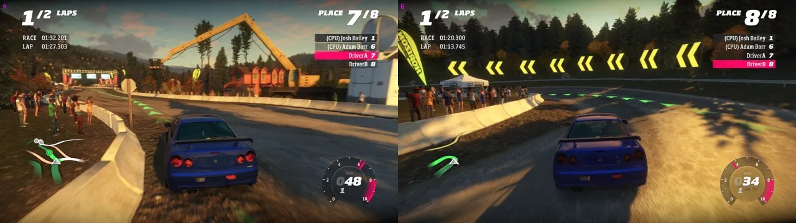
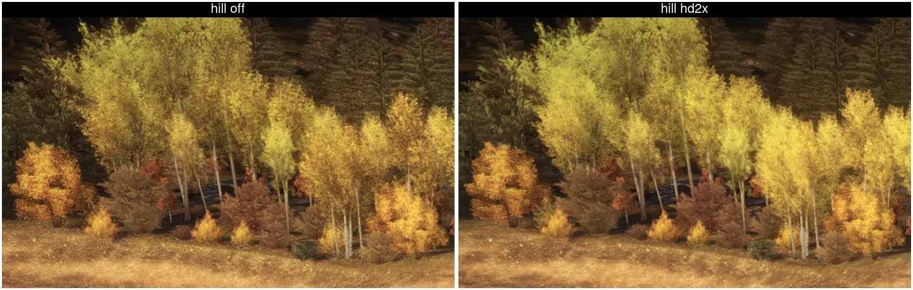
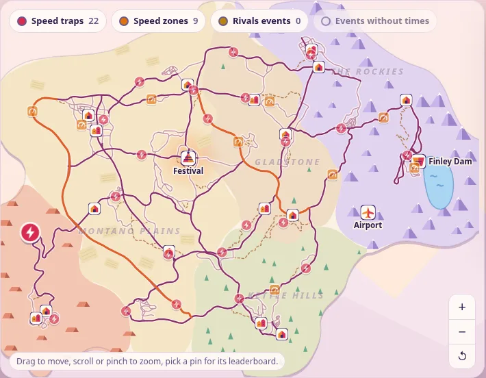
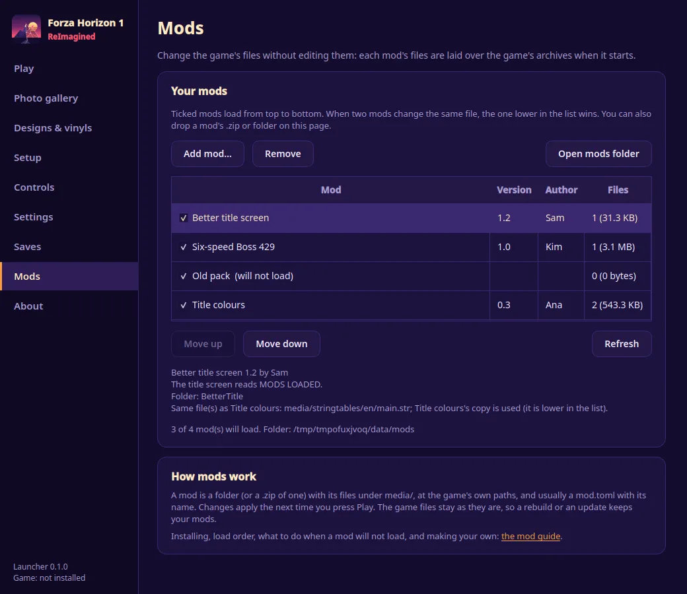
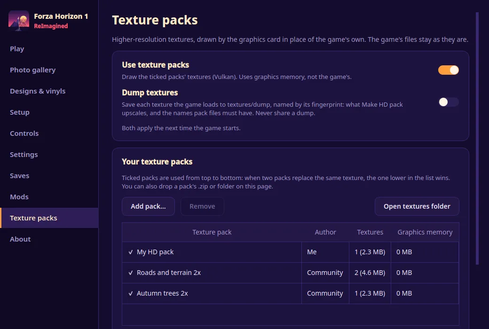

<p align="center">
  
</p>

<h1 align="center">Forza Horizon 1: ReImagined</h1>

> [!TIP]
> **Install with the launcher: [latest release](https://github.com/FH1-ReImagined/ForzaHorizon1-ReImagined/releases/latest).**
> Windows installer, Linux Flatpak (recommended on SteamOS: [Steam Deck steps](docs/steam_deck.md)), or the Linux `.tar.gz`.
> It updates itself, and it builds the game on your PC from your own copy.
> [Website](https://forza.dyotson.dev) · [Discord](https://discord.gg/yu7zScdcWw)

> [!IMPORTANT]
> **macOS is a source-build experiment.** The launcher does not support macOS, and there is no Mac download.
> Opening drives render on Apple Silicon. Full races, save reloads and physical controllers still need validation.
> [macOS setup and limits](docs/macos.md)

<p align="center">
  The original 2012 Forza Horizon, running natively on PC: single player, online free roam,
  leaderboards and rivals, on Windows and Linux.
</p>

**Forza Horizon 1: ReImagined** runs **Forza Horizon (Xbox 360)** natively on Windows and Linux.
The original PowerPC executable is statically recompiled to C++ with the
[ReXGlue SDK](https://github.com/rexglue/rexglue-sdk), the same approach as
[RecompiledHaloReach](https://github.com/Dyotson/RecompiledHaloReach). On top of that build the project adds:

- **Single player, Title Update 4 and DLC.** The whole festival, Horizon Rally, the 1000 Club and all 23 DLC packages. [`docs/dlc.md`](docs/dlc.md)
- **Online through Forza Live.** Horizon World, friends, leaderboards and Rivals, on a public server or your own. [`docs/online_vision.md`](docs/online_vision.md)
- **Co-op campaign.** Friends race festival events together; the launcher applies eligible career results after the game closes. [`docs/coop_campaign.md`](docs/coop_campaign.md)
- **Mods and HD texture packs.** [`docs/modding.md`](docs/modding.md) · [`docs/texture_packs.md`](docs/texture_packs.md)
- **A frame rate you set.** 30 fps is the original; the setting goes up to 240 on a PC that can hold it.

This repository contains **no game code and no game data**. You need your own copy of the
game (a disc image, a Games on Demand package, or an extracted folder). The recompiled
C++ is generated from that copy on your machine. No game binaries are published here.

## Contents

- [Screenshots](#screenshots)
- [What you can play](#what-you-can-play)
- [Performance](#performance)
- [Known issues](#known-issues)
- [Requirements](#requirements)
- [Install with the launcher](#install-with-the-launcher)
- [Building from source](#building-from-source)
- [Playing](#playing)
- [More documentation](#more-documentation)
- [Roadmap](#roadmap)
- [Community](#community)
- [Privacy](#privacy)
- [Code signing policy](#code-signing-policy)
- [Legal](#legal)

## Screenshots

Captured from the recompiled game and its launcher.

| | |
|---|---|
| <br>Free roam | <br>Circuit race against 7 AI drivers |
| <br>Co-op Festival race, two players and CPU drivers | <br>Horizon World online playlist |
| <br>Original textures (left) and a 2x HD pack (right) | <br>The [leaderboards](https://forza.dyotson.dev/leaderboards.html) on a map of Colorado |
| <br>The launcher's Mods page | <br>The launcher's Texture packs page |

## What you can play

- **Single player, Title Update 4 and DLC.** TU4 is the default when you give the launcher your update; Horizon Rally and the 1000 Club need it. All 23 DLC packages count as installed. [`docs/dlc.md`](docs/dlc.md)
- **Co-op Festival** (Multiplayer > Find Game). The host types `/event FR05` in chat and everyone races that event. Start through the launcher: it applies eligible career results after the game closes. A loaner car is lent if you have none that fits. [`docs/coop_campaign.md`](docs/coop_campaign.md)
- **Mods.** The **Mods** page: **Add mod...**, on or off, load order. [`docs/modding.md`](docs/modding.md)
- **HD texture packs** (Vulkan). Add a community pack, or **Make HD pack** with a local AI upscaler. Packs are compressed. [`docs/texture_packs.md`](docs/texture_packs.md)
- **Controls.** Keyboard and mouse, gamepad, or a wheel with force feedback (Logitech G29, G920 and G923 tested). DualSense adaptive triggers are optional. [`docs/playing.md`](docs/playing.md)
- **Picture.** AMD FSR 1 and 3, CAS, SMAA, NVIDIA DLSS and DLAA (Windows, RTX), render scale, HDR, ultrawide. [`docs/rendering.md`](docs/rendering.md) · [`docs/hdr.md`](docs/hdr.md) · [`docs/ultrawide.md`](docs/ultrawide.md) · [`docs/antialiasing.md`](docs/antialiasing.md)
- **Weak PCs.** A 540p 3D scene (about 44% more fps when the graphics card is the limit), **World detail** (shadows, distant textures) and scene anti-aliasing (MSAA) Off or 2x. Steam Deck: [`docs/steam_deck.md`](docs/steam_deck.md)
- **Frame rate.** 20 to 240 fps, or Match display.
- **Radio.** **Settings > Audio > Radio > Station changes: Fast** flips stations quickly.
- **Photos, saves, unicorn cars.** Photo gallery, automatic save backups, a profile editor and the seven unicorn cars. [`docs/unicorn_cars.md`](docs/unicorn_cars.md)
- **Online.** See [Playing online](#playing-online).

## Performance

The game's original cap is 30 fps. On a low-end PC or a Steam Deck, leave it there. **Settings > Display > Frame rate** at 60 or higher is for a PC that can hold it.

These numbers are from one machine, a Ryzen 7 7800X3D with a Radeon RX 9060 XT ([`docs/framerate.md`](docs/framerate.md), [`docs/perf.md`](docs/perf.md)). 0 to 100 km/h took about 2.4 seconds at every rate on that PC. Above 60 fps the race is bound by the GPU emulation there; the game's main loop still ran at the target rate.

| `frame_rate` | Free roam | Race, 7 AI cars (Clear Springs Circuit) |
|---|---|---|
| 60 | 59.9 fps | 59.6 fps |
| 120 | 115.2 fps | 75.7 fps |
| 144 | 111.5 fps | 70.1 fps |

Steam Deck players report about 15–20 fps in free roam, and less in a big race ([#45](https://github.com/FH1-ReImagined/ForzaHorizon1-ReImagined/issues/45), [#140](https://github.com/FH1-ReImagined/ForzaHorizon1-ReImagined/issues/140)). A Deck test of 0.1.27 was about 17 fps in free roam and about 8 fps in an 8-car race. 4-core laptops and integrated GPUs report about 15–25 fps ([#263](https://github.com/FH1-ReImagined/ForzaHorizon1-ReImagined/issues/263), [#268](https://github.com/FH1-ReImagined/ForzaHorizon1-ReImagined/issues/268)). The launcher's Deck preset is render scale 1 with AMD FSR 1, 30 fps (40 with the screen at 40 Hz), Scene anti-aliasing Off and Console detail. Higher render scales and 60 fps cost more than the Deck has to spare. Install, settings, controls and suspend: [`docs/steam_deck.md`](docs/steam_deck.md).

Shader prebuild and the shader-cache fixes shipped in 0.1.28. Further CPU savings for 4-core systems are in testing ([#45](https://github.com/FH1-ReImagined/ForzaHorizon1-ReImagined/issues/45)). [`docs/shader_prebuild.md`](docs/shader_prebuild.md) · [`docs/perf.md`](docs/perf.md)

## Known issues

- **Low-end CPUs and the Steam Deck.** Free roam is about 15–20 fps on a Deck and about 15–25 fps on a 4-core laptop or an integrated GPU. Big races are slower. Use 30 fps. Work is in progress ([#45](https://github.com/FH1-ReImagined/ForzaHorizon1-ReImagined/issues/45), [#140](https://github.com/FH1-ReImagined/ForzaHorizon1-ReImagined/issues/140), [#263](https://github.com/FH1-ReImagined/ForzaHorizon1-ReImagined/issues/263), [#268](https://github.com/FH1-ReImagined/ForzaHorizon1-ReImagined/issues/268)).
- **NVIDIA.** Stutter on Vulkan with a warm shader cache ([#49](https://github.com/FH1-ReImagined/ForzaHorizon1-ReImagined/issues/49), [#158](https://github.com/FH1-ReImagined/ForzaHorizon1-ReImagined/issues/158)), green texture glitches ([#106](https://github.com/FH1-ReImagined/ForzaHorizon1-ReImagined/issues/106)), flicker and coloured artifacts at render scale 3 ([#47](https://github.com/FH1-ReImagined/ForzaHorizon1-ReImagined/issues/47)), and flicker and greenish reflections on Direct3D 12 ([#46](https://github.com/FH1-ReImagined/ForzaHorizon1-ReImagined/issues/46)). On Windows, **Settings > Display > Graphics API** should stay on Vulkan unless you are comparing. Some fast NVIDIA PCs also report the game barely using the machine ([#181](https://github.com/FH1-ReImagined/ForzaHorizon1-ReImagined/issues/181), [#34](https://github.com/FH1-ReImagined/ForzaHorizon1-ReImagined/issues/34)).
- **Crashes.** A bad guest read during a race is still open ([#83](https://github.com/FH1-ReImagined/ForzaHorizon1-ReImagined/issues/83)). Quitting to the title screen can crash ([#262](https://github.com/FH1-ReImagined/ForzaHorizon1-ReImagined/issues/262)). Alt-tab on some NVIDIA systems aborts the game ([#221](https://github.com/FH1-ReImagined/ForzaHorizon1-ReImagined/issues/221)). A race crash that exited with code 134 ([#182](https://github.com/FH1-ReImagined/ForzaHorizon1-ReImagined/issues/182)) is fixed in 0.1.28; if you still hit it, comment there. Flashing or black video is still open on some AMD and Intel machines ([#91](https://github.com/FH1-ReImagined/ForzaHorizon1-ReImagined/issues/91), [#114](https://github.com/FH1-ReImagined/ForzaHorizon1-ReImagined/issues/114)).
- **Title Update 4 and the base game do not share rooms.** A TU4 game only meets other TU4 players. A profile that has been saved on TU4 is refused by the base game ("MISSING TITLE UPDATE"). [`docs/dlc.md`](docs/dlc.md#online-20)

Other open reports include a lobby that stops taking joins after time in a club ([#186](https://github.com/FH1-ReImagined/ForzaHorizon1-ReImagined/issues/186)) and an online level reset ([#245](https://github.com/FH1-ReImagined/ForzaHorizon1-ReImagined/issues/245)).

## Requirements

- Windows 10/11 64-bit, or Linux x86-64. Windows can use Vulkan or Direct3D 12. Linux uses Vulkan. Vulkan 1.3 is what the Vulkan path asks for.
- About 4 GB of free RAM while playing (the game peaks near 1.1 GB). A build needs more: about 2 GB at 4 jobs, about 3.2 GB at 8. About 15 GB of disk. [`docs/launcher.md`](docs/launcher.md)
- Your own copy of Forza Horizon: a disc image, a Games on Demand package, or an extracted folder. Title Update 4 and DLC are optional. TU4 is what you want for Horizon Rally and the 1000 Club.
- A controller, a keyboard and mouse, or a wheel.

## Install with the launcher

This is the way to install. The launcher builds the game on your machine from your own files. Nothing of the game is downloaded.

1. Get the launcher from the [latest release](https://github.com/FH1-ReImagined/ForzaHorizon1-ReImagined/releases/latest). On Windows, the installer. On Linux, the Flatpak (recommended on SteamOS) or the `.tar.gz`. From v0.1.9 onward the launcher checks for updates itself (**About > Launcher updates**).
   The Flatpak is `flatpak install --user ForzaHorizon1-ReImagined-x86_64.flatpak`. It pulls the freedesktop SDK runtime from Flathub. Install the compiler extension once, or the launcher downloads a 2 GB compiler instead and tells you so:

   ```sh
   flatpak install flathub org.freedesktop.Sdk.Extension.llvm22//26.08
   ```

   **On SteamOS (Steam Deck):** in Desktop Mode, download the `.flatpak` and open it in Dolphin (Discover installs it) or run the command above, install the compiler extension, then in Steam choose **Games > Add a Non-Steam Game to My Library** and pick **Forza Horizon 1: ReImagined**. It then starts from Game Mode. [`docs/steam_deck.md`](docs/steam_deck.md)

2. In Setup, **Game files**: your disc image, Games on Demand package, or an extracted folder. **Updates & DLC**: Title Update 4 and your DLC folder, if you have them.
3. **Build.** The launcher generates the game from your copy and compiles it. A measured build at 4 jobs on an 8-core PC took about 4.6 minutes ([`docs/launcher.md`](docs/launcher.md)). It can be cancelled and resumed, and it runs again only when something changed.
4. **Prebuild shaders** (optional, Vulkan). This builds pipelines from your own game files before you play, so the first visit to a place stutters less. The launcher offers it again after a driver, launcher or graphics-setting change. [`docs/shader_prebuild.md`](docs/shader_prebuild.md)
5. **Play.** Settings cover display, controls, audio, online, profile and advanced options. **Saves** is the backup and profile editor.

Details: [`docs/launcher.md`](docs/launcher.md).

To verify a download when its release includes `SHA256SUMS`, download that file from the
same release. On Windows, run `certutil -hashfile .\YourDownloadedSetup.exe SHA256` or, in
PowerShell, `Get-FileHash .\YourDownloadedSetup.exe -Algorithm SHA256`, and compare the hash with
the matching filename in `SHA256SUMS` ([details](docs/launcher.md#verify-your-download)).
On Linux, put both files in the same folder and run
`sha256sum --ignore-missing -c SHA256SUMS`. A match confirms the downloaded bytes match
the published checksum; it does not certify that the program is safe or code-signed.

Windows releases also include `ForzaHorizon1-ReImagined-windows-files-<version>.json`,
with hashes for the installed payload and a link to the build that produced it.
The same document is installed as `windows-build-manifest.json`. If antivirus
quarantines a file, report the exact file path, detection name and launcher version
from Protection history. The published manifest can identify the expected file
without restoring it. Signing and antivirus assessment remain separate work
([#354](https://github.com/FH1-ReImagined/ForzaHorizon1-ReImagined/issues/354)).

## Building from source

For developers. Players should use the launcher.

Linux configure and the pinned SDK are in [`docs/PROJECT.md`](docs/PROJECT.md). Title Update 4 is in [`docs/dlc.md`](docs/dlc.md). The Windows cross-compile is `tools/build_windows.sh` ([`docs/launcher.md`](docs/launcher.md)). macOS is [`docs/macos.md`](docs/macos.md). A source tree launches with `tools/play.sh` ([`docs/playing.md`](docs/playing.md)).

## Playing

Use the launcher's Play button. It signs in to the Forza Live server unless you pick **Offline**.

To keep playing a Xenia Canary career, choose **Settings > Profile > Continue a Xenia Canary save**. The launcher copies that save once. The original Xenia files are not modified. [`docs/playing.md`](docs/playing.md)

### Playing online

In **Settings > Online**, pick one:

- **Public server.** Horizon World, leaderboards and rivals. The address filled in is `forza-reimagined.playit.plus:56677`. You forward no ports.
- **This PC.** A private server for this session.
- **My own server.** [Hosting guide](https://github.com/FH1-ReImagined/forza-live/blob/main/docs/hosting.md) in [forza-live](https://github.com/FH1-ReImagined/forza-live), the server's repository. Python 3 from the standard library, or Docker.
- **Offline.** No Xbox LIVE.

Horizon World is the first playlist under Multiplayer, Find Game. The server places you in the fullest open world, up to 8 players, or you open one and drive. Someone who joins later gets JUMP IN. When the host leaves, the others keep driving. Each world is its own session. A local test has run with three players. [`docs/online_vision.md`](docs/online_vision.md)

Friends (F8, or hold the left stick on a controller) and chat (F9) use the server's list. Leaderboards cover speed traps, speed zones, events and Rivals (times, ghosts and bounties), and the public server's are on the [website](https://forza.dyotson.dev/leaderboards.html). Car clubs and the Message Center work. The club garage can share a car. [Title services](https://github.com/FH1-ReImagined/forza-live/blob/main/docs/title_services.md) · [`docs/playing.md`](docs/playing.md)

Title Update 4 players and base-game players do not meet. The Auction House has no screens in this game. The server can store auctions, and there is nowhere in the game to open them.

## More documentation

[`docs/launcher.md`](docs/launcher.md),
[`docs/playing.md`](docs/playing.md),
[hosting a server](https://github.com/FH1-ReImagined/forza-live/blob/main/docs/hosting.md) (forza-live),
[`docs/perf.md`](docs/perf.md),
[`docs/framerate.md`](docs/framerate.md),
[`docs/online_vision.md`](docs/online_vision.md),
[`docs/PROJECT.md`](docs/PROJECT.md),
and the [issue tracker](https://github.com/FH1-ReImagined/ForzaHorizon1-ReImagined/issues).

## Roadmap

Where the project is heading, on the [ReImagined Roadmap](https://github.com/users/Dyotson/projects/3):

1. **Stable everywhere** (in progress): the game runs well on any PC, GPU and the Steam Deck.
2. **Multiplayer as cool as possible:** Horizon World, challenges, ranked, clubs, sharing tunes and liveries.
3. **Modding, and more multiplayer:** a mod loader, car and tuning mods, custom events, mod sync online.
4. **Decompilation and custom game:** readable C++ game systems, new modes, decoupled physics, better AI.

Every card is an issue. Comment there to discuss an item or help with it.

## Community

Questions, help with setup and online sessions: [Discord](https://discord.gg/yu7zScdcWw).
Bugs and feature requests: [issues](https://github.com/FH1-ReImagined/ForzaHorizon1-ReImagined/issues).
The website's source is in [FH1-ReImagined/website](https://github.com/FH1-ReImagined/website).
The bug report template asks for your OS, CPU, GPU and log.

## Privacy

The launcher and the game have no analytics or telemetry. With the default settings, the game plays online on the project's public server, the launcher shares shader lists with that server and asks it for your co-op campaign results after you play, checks GitHub for launcher updates, and the game shows your activity in Discord. The Windows installer's **Online features** option, or the question the launcher asks the first time it opens on Linux, turns all of that off, and each feature can be turned off on its own in the launcher. What each one sends, what the public server keeps and for how long, and what is public: [`PRIVACY.md`](PRIVACY.md).

## Code signing policy

Windows builds will be signed through [SignPath Foundation](https://signpath.org); until then they are unsigned.

What we sign: the Windows launcher `forza-launcher.exe` and the installer `ForzaHorizon1-ReImagined-Setup-<version>.exe`. They are built by GitHub Actions from this repository ([release workflow](.github/workflows/release.yml)), and a maintainer approves each release by hand before it is signed.

What we don't sign: third-party files we ship (Python, Qt/PySide6, SDL2, the Microsoft Visual C++ runtime) are included as their publishers released them, with the publishers' own signatures where they have one. `forza.exe`, which the launcher builds on your PC from your own copy of the game, is never signed by us. The Linux packages are not code-signed; check them against `SHA256SUMS` (see [Install with the launcher](#install-with-the-launcher)).

Team roles:
- Committers and reviewers: [Dyotson](https://github.com/Dyotson), [soconnor0919](https://github.com/soconnor0919)
- Approvers: [Dyotson](https://github.com/Dyotson), [soconnor0919](https://github.com/soconnor0919)

Pull requests from people outside this team are reviewed by a team member before they are merged.

Privacy: see our [privacy policy](PRIVACY.md).

## License

Forza Horizon 1: ReImagined is free software under the
[GNU General Public License, version 3 or later](LICENSE) (GPL-3.0-or-later), with an additional
permission that lets the game and launcher work with the graphics, VR and platform components
your PC supplies (NVIDIA's DLSS runtime, graphics drivers, OpenXR runtimes, the Discord client,
system libraries). The permission, third-party licenses and the history are in
[`NOTICE.md`](NOTICE.md). Releases and commits before this license change were published under the MIT
License and stay available under it. The online server,
[Forza Live](https://github.com/FH1-ReImagined/forza-live), and the
[website](https://github.com/FH1-ReImagined/website) are under the GNU Affero General Public
License, version 3 or later.

## Legal

Forza Horizon is © Microsoft. This project is not affiliated with, endorsed by or
sponsored by Microsoft, Playground Games or Turn 10 Studios. Forza, Forza Horizon, Xbox and Xbox LIVE are trademarks of Microsoft. It contains no game code or
assets; you must own the game. See [`LICENSE`](LICENSE) and [`NOTICE.md`](NOTICE.md).
